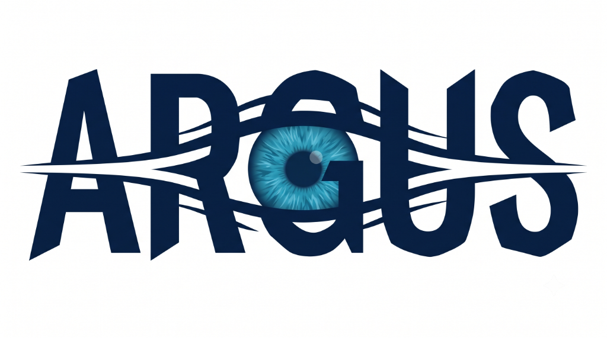

# Argus Mobile &bull; Urban Flood &amp; Hazard Intelligence Client

Official mobile application workspace for the **Argus** civic intelligence platform. This repository is specifically tailored for mobile frontend design and development, consuming the shared Argus serverless backend.



---

## 🎯 Purpose & Architecture

Argus predicts urban waterlogging vulnerability and enforces contractor defect liability across Delhi NCR. 

While the **desktop platform** (`argus` repository) provides an executive operations console for command centers and engineers, **Argus Mobile** is designed for citizens, field inspectors, and on-ground teams:
- **Instant Hazard Photo Reporting**: Citizen camera capture inspected by Amazon Bedrock (Nova 2 Lite).
- **Corridor Flood Risk Intelligence**: Live precipitation-driven vulnerability rankings and underwater hazard indicators.
- **Contractor Accountability Tracking**: Civic defect warranty timelines and escalation ladder monitoring.

```
┌────────────────────────────────────────────────────────┐
│                   ARGUS PLATFORM                       │
└──────────────────────────────────┬─────────────────────┘
                                   │
         ┌─────────────────────────┴─────────────────────────┐
         ▼                                                   ▼
┌─────────────────────────────────┐         ┌─────────────────────────────────┐
│     argus (Desktop & Backend)   │         │          argus-mobile           │
│  - AWS Serverless Backend       │         │  - Mobile Frontend Workspace    │
│  - Step Functions & Bedrock     │         │  - Touch & Camera UX            │
│  - Desktop Executive Console    │         │  - Field Inspector Tools        │
└─────────────────────────────────┘         └─────────────────────────────────┘
                               ▲                             │
                               └────── OpenAPI Contracts ────┘
```

---

## 🚀 Quickstart for Mobile Developers

### 1. Install & Run Dev Server
```bash
git clone https://github.com/argus/argus-mobile.git
cd argus-mobile
npm install
npm run dev
```

Open `http://localhost:5174` in your desktop browser, or test on your physical phone by connecting to the same Wi-Fi network and opening the displayed local network URL!

---

## 🛠️ Framework Agnostic: Choose Your Stack

This workspace is structured so you can proceed with:
1. **The Included Lightweight Mobile Web / PWA App**:
   - Ready-to-use React 18 + Tailwind CSS touch UI.
   - Zero native build dependencies or Xcode/Android Studio setups needed.
2. **React Native / Expo**:
   - If you prefer compiling native iOS & Android binaries, simply use the contracts in `contracts/openapi.yaml` and types in `src/api/types.ts`. All endpoints and mock structures match 1:1.
3. **Flutter**:
   - Generate Dart models directly from `contracts/openapi.yaml` using `openapi-generator`.

---

## 📦 Project Structure

```
argus-mobile/
├── contracts/
│   └── openapi.yaml           # Synced backend OpenAPI 3.0 specification
├── src/
│   ├── api/
│   │   └── types.ts           # TypeScript interfaces matching backend models
│   ├── mocks/
│   │   └── data.ts            # Offline seed data (hotspots, risks, cases)
│   ├── components/            # Mobile navigation, headers, cards, modals
│   ├── screens/               # Mobile views (Corridors, Map, Report, Cases)
│   ├── App.tsx
│   └── main.tsx
├── MOBILE_APP_SPEC.md         # Full UX & screen specifications
├── API_REFERENCE.md           # Backend endpoint documentation
└── CONTRIBUTING.md            # Git branching and contribution guide
```

---

## 🤝 For Teammates: Contributing

We welcome contributions from everyone on the team!
1. **Fork** or clone the repo.
2. Create a feature branch: `git checkout -b feature/your-screen-name`
3. Commit your changes: `git commit -m "feat: design new report confirmation sheet"`
4. Push and open a Pull Request!

See [CONTRIBUTING.md](./CONTRIBUTING.md) for full details.
